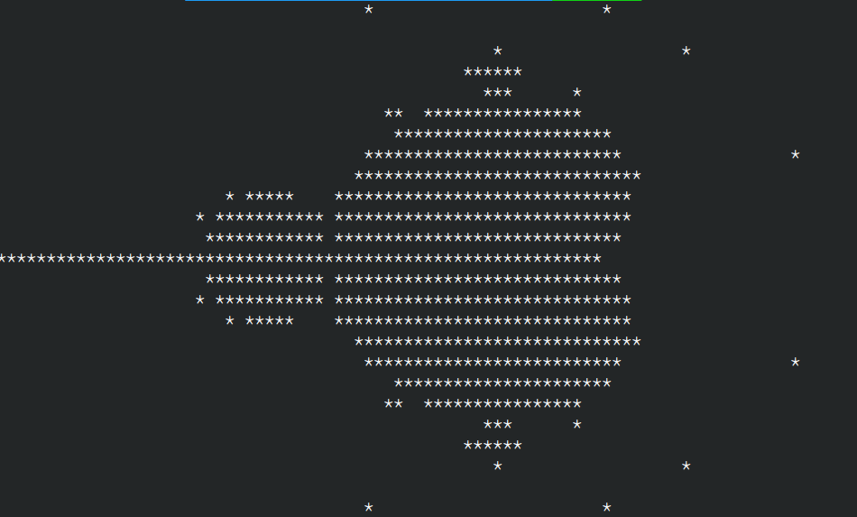
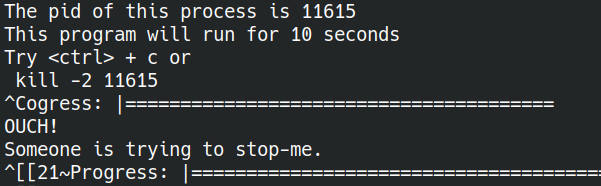

# ruby-sandbox
A collection of proof of concepts written in ruby.

## Mandelbrot

## Trap-signal

## MIDI Controller Stream Reader

🎹 Prova de conceito que lê eventos MIDI de um controlador e os exibe em tempo real para fins de depuração.

- **Teste sem hardware:** `ruby midi_controller/test_simulator.rb`
- **Com controlador real:** `ruby midi_controller/midi_reader.rb`
- **Documentação:** Ver `midi_controller/README.md` e `midi_controller/QUICKSTART.md`

Suporta NOTE ON/OFF, Control Change, Program Change, Pitch Bend, etc. com formatação legível.

